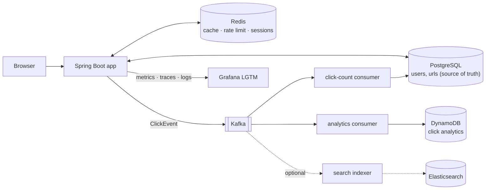
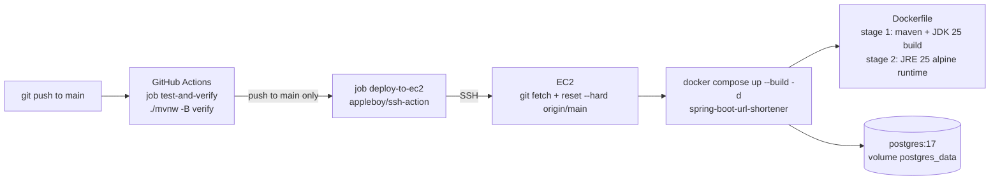

_Last Updated: 2026-11-05_

# TinyURL
## A project to learn System Design

Technology Stack
- Spring Boot 4.1.2
- bootstrap@5.3.8 -> later React
- DB : Docker/PostgreSQL with Flyway Migrations
- Planned: see [TO-DO](#to-do)

## TO-DO
Each technology is added on its own feature branch (merged by PR) and is first run **locally in Docker**.
EC2 deployment of the new services is planned only once the whole local stack works.

### Target architecture


### Roadmap
| # | Branch | Scope | Local Docker services | Status |
|---|---|---|---|---|
| 0 | — | Restore the Maven wrapper (`mvnw`, `mvnw.cmd`) | — | ✅ Done |
| 1 | `feature/testing` | Unit tests (JUnit 5, Mockito, AssertJ), slice tests (`@WebMvcTest` + security, `@DataJpaTest`, `@JdbcTest`), Testcontainers integration tests, JaCoCo coverage report. Bugs the tests found and this branch fixes: `@PreAuthorize` was ignored (no `@EnableMethodSecurity`, so any user could open `/admin/dashboard`); short keys were not checked for collisions; error pages returned HTTP 200; a missing `isPrivate` field caused an NPE. See [Testing](#testing) | Postgres (Testcontainers) | ✅ Done |
| 2 | `feature/observability` | Structured JSON logs with `traceId`, Micrometer → Prometheus metrics, OpenTelemetry traces, Grafana dashboards. k6 load-test script that records the **baseline** redirect latency | `grafana/otel-lgtm` (Grafana, Prometheus, Tempo, Loki), k6 | ⬜ Planned |
| 3 | `feature/redis` | Cache-aside for `shortKey → url` on `/s/{shortKey}` (TTL = time left until `expiresAt`, evicted on delete; private-link owner check still applied). Redis-backed rate limit on `POST /short-urls`. k6 before/after comparison | Redis | ⬜ Planned |
| 4 | `feature/kafka-click-events` | The redirect publishes a `ClickEvent` (shortKey, timestamp, referrer, user-agent) and returns at once. A consumer updates `click_count` in batches, which removes the row write from the redirect path | Kafka (KRaft, single node), Kafka UI | ⬜ Planned |
| 5 | `feature/dynamodb-analytics` | Second Kafka consumer writes every click to DynamoDB (partition key `shortKey`, sort key `timestamp`, TTL). Per-link analytics page (clicks per day). **Analytics only**: users and URLs stay in Postgres. AWS SDK v2 Enhanced Client | `amazon/dynamodb-local` | ⬜ Planned |
| 6 | `feature/elasticsearch-search` | **Optional.** Search URLs (e.g. "all links to github.com") from an index fed by `url-created` events (CQRS read model) | Elasticsearch (heap capped) | ⬜ Optional |

### Later
- **Horizontal scaling:** nginx load balancer in front of 2 app replicas, Spring Session in Redis
- **Resilience4j:** timeout + circuit breaker around `UrlExistenceValidator`, fallback to Postgres when Redis is down
- **Cleanup job:** `@Scheduled` removal of expired URLs (ShedLock once there are several replicas)
- **REST API + OpenAPI** (springdoc)
- **React** frontend replacing Thymeleaf
- **EC2 deployment** of the full stack

### Decided against
| Tech | Reason |
|---|---|
| DynamoDB for users/URLs | The data is relational (FK, sort by `createdAt`, offset pagination); Postgres fits it better |
| ELK for logs | Duplicates the Grafana stack; one observability stack only |
| ZooKeeper | Kafka runs in KRaft mode |
| Kubernetes, microservices split, a second NoSQL store | More moving parts without new lessons for a monolith this size |

### Local Docker conventions
- Every new service goes into `compose.yaml` behind its own **compose profile** (e.g. `cache`, `messaging`, `observability`, `analytics`, `search`). `spring-boot-docker-compose` runs `docker compose up` on every app start, so the profiles keep `spring-boot:run` from starting the whole stack; choose them with `spring.docker.compose.profiles.active`.
- Rough memory budget: Postgres 0.1 GB, Redis < 0.05 GB, Kafka 0.6 GB, Kafka UI 0.3 GB, Grafana LGTM 1 GB, DynamoDB Local 0.2 GB, Elasticsearch 1 GB. That is about 3.5 GB with everything running; check Docker Desktop's WSL memory limit.
- Each branch adds Testcontainers tests for its service, so `./mvnw verify` keeps working in CI without compose.

## Features
- Shorten long URLs with a randomly generated short key (optional check that the original URL exists)
- Redirect `/s/{shortKey}` to the original URL, with a click counter
- Private short URLs (visible/accessible only to their creator) and a custom expiry (1–365 days, default 30)
- Paginated public URL list, "My URLs" page and admin dashboard with Prev/Next navigation
- User registration and form login with Spring Security (BCrypt passwords)
- Role-based, method-level security (`@PreAuthorize`) with a role hierarchy `ROLE_ADMIN > ROLE_USER`
- Users can delete their own short URLs
- Custom 404 / 500 error pages

## Architecture
Single Spring Boot MVC app rendered server-side with Thymeleaf + Bootstrap.

| Layer | Package / Location | Notes |
|---|---|---|
| Web | `web.controller` (`HomeController`, `UserController`, `AdminController`), `GlobalExceptionHandler` | Thymeleaf views in `src/main/resources/templates` |
| Security | `config.WebSecurityConfig`, `services.SecurityUserDetailsService` | Form login, role hierarchy, method security |
| Service | `services` (`ShortUrlService`, `UserService`, `UrlExistenceValidator`, `EntityMapper`) | |
| Persistence | `repository` | `ShortUrlRepository` uses Spring Data JPA; `UserRepository` uses Spring `JdbcClient` |
| Database | PostgreSQL 17 | Schema & seed data via Flyway (`src/main/resources/db/migration`) |

## Prerequisites
- Java 25
- Docker (PostgreSQL container, and building/running the app container)
- Maven (or the bundled `mvnw` wrapper)

## Running the app
The app runs in three ways, all from the same `compose.yaml`.
For a step-by-step walkthrough of what each command triggers internally (Maven lifecycle, Dockerfile stages, compose, GitHub Actions), see **[code-flow.md](code-flow.md)**.

| Pathway | Postgres | App | URL |
|---|---|---|---|
| **1. Local**: app in your JVM | Local Docker | `./mvnw spring-boot:run` / IDE | http://localhost:8080 |
| **2. Local full stack** | Local Docker | Local Docker (built from the `Dockerfile`) | http://localhost:8080 |
| **3. EC2** (live) | Docker on EC2 | Docker on EC2, deployed by GitHub Actions | `http://<elastic-ip>:8080` |

### 1. Local: Postgres in Docker, app in your JVM
**First run**
1. Install JDK 25 and **start Docker Desktop** (`docker info` must succeed).
2. Optional: `cp .env.example .env` to change the DB credentials (without it, `postgres`/`postgres` and DB `postgresDB` are used).
3. Run the app:
   ```bash
   ./mvnw spring-boot:run          # Windows PowerShell: .\mvnw.cmd spring-boot:run
   ```
   `spring-boot-docker-compose` runs `docker compose up` for you, so only **postgres** starts (the app service is behind the `app` profile).
   The first run pulls `postgres:17` and creates the `url_shortner_postgres_data` volume, and Flyway applies `V1`–`V3` (tables + sample data).
   You can also run `UrlShortnerApp` from the IDE, with the repo root as the working directory.
4. Open http://localhost:8080 and log in with one of the sample accounts below.

**Subsequent runs**
- Run `./mvnw spring-boot:run` again. Postgres keeps running between runs (`lifecycle-management=start_only`), and Flyway only applies new `V*__*.sql` files.
- Stop Postgres: `docker compose down`. Wipe all data and re-seed: `docker compose down -v`.

### 2. Local full stack: app also in Docker
A local dress rehearsal of the EC2 setup:
```bash
docker compose up --build -d spring-boot-url-shortener   # builds the image, starts postgres (healthy) → app
docker logs -f shortener-app                              # follow startup
docker compose --profile app down                         # stop both; data stays in the volume
```
After a code change, run the same `up --build` command again: only the changed layers are rebuilt.
Stop any `spring-boot:run` first, because both use port 8080.

### 3. EC2: automatic deploy
**First run:** do the [One-time EC2 setup](#one-time-ec2-setup) below (instance, Docker, server `.env`, GitHub secrets), then push to `main`.
**Subsequent updates:** `git push origin main`. GitHub Actions runs the tests, then SSHes into EC2 to `git reset` and `docker compose up --build`.
Details: [Deployment: build on EC2](#deployment-build-on-ec2).

Sample accounts seeded by Flyway:

| Email | Password | Role |
|---|---|---|
| `admin@gmail.com` | `admin` | ADMIN |
| `siva@gmail.com` | `secret` | USER |

### Configuration (`application.properties`)
| Property | Default | Purpose |
|---|---|---|
| `app.base-url` | `http://localhost:8080` | Prefix for generated short links |
| `app.default-expiry-days` | `30` | Expiry when none is given |
| `app.validate-original-url` | `true` | Check the original URL is reachable |
| `app.page-size` | `10` | Page size for paginated lists |

## Testing
Tests need Docker running: Testcontainers starts a throwaway `postgres:17` with the Flyway migrations applied, so your dev DB is never touched.

| Command | Runs |
|---|---|
| `./mvnw test` | Unit + slice tests (`*Test`, Surefire) |
| `./mvnw verify` | The above + integration tests (`*IT`, Failsafe) + coverage report at `target/site/jacoco/index.html`. CI runs this |
| `./mvnw test -Dtest=HomeControllerTest` | One test class |

| Layer | Classes | Spring context | Database |
|---|---|---|---|
| Unit | `services/*Test` | None (JUnit 5 + Mockito + AssertJ) | — |
| Web slice | `web/controller/*Test` | `@WebMvcTest`: MVC, Thymeleaf, real `WebSecurityConfig`; services are `@MockitoBean` | — |
| Persistence slice | `repository/*Test` | `@DataJpaTest` / `@JdbcTest` | Testcontainers Postgres, each test rolled back |
| Integration | `*IT` (extend `AbstractIntegrationTest`) | Full `@SpringBootTest` + MockMvc, nothing mocked | Testcontainers Postgres, shared by all ITs |

All `*IT` classes share one configuration in `AbstractIntegrationTest`, so Spring boots the app and its container once for all of them.

## Usage
| Endpoint | Access | Description |
|---|---|---|
| `GET /?page=1` | Public | Home: create form + public short URLs |
| `POST /short-urls` | Public | Create a short URL (`originalUrl`, `expirationInDays`, `isPrivate`) |
| `GET /s/{shortKey}` | Public (private links: owner only) | Redirect to the original URL |
| `GET/POST /register` | Public | Register a new user |
| `GET /login`, `POST /logout` | Public | Login / logout |
| `GET /my-urls?page=1` | Authenticated | Current user's short URLs |
| `POST /delete-urls` | USER | Delete selected URLs (`ids`) |
| `GET /admin/dashboard?page=1` | ADMIN | All short URLs |

## Deployment: build on EC2

**Status:** live on EC2. Every push to `main` is tested and then deployed automatically.

The Docker image is **built on the EC2 instance itself** from the `Dockerfile` — no image registry (Docker Hub) is involved.
GitHub Actions only runs the tests and then tells EC2 (over SSH) to pull the latest code and rebuild.



### How the files fit together
| File | Role |
|---|---|
| `.github/workflows/deploy.yml` (at the **repo root**, `tinyURL/.github/`) | Workflow *"CI & EC2 Zero-Credit Deploy"*: job `test-and-verify` runs on PRs and pushes; job `deploy-to-ec2` runs only on push to `main`, after the tests pass. GitHub only reads workflows from the repository root. |
| `Dockerfile` | Multi-stage build. Stage 1 (`maven:3.9-eclipse-temurin-25`) downloads dependencies, then `mvn package` builds the fat jar; stage 2 (`eclipse-temurin:25-jre-alpine`) runs it with `java -jar /app/app.jar` |
| `pom.xml` → `spring-boot-maven-plugin` | Repackages `target/*.jar` into the executable fat jar the Dockerfile copies (also provides `spring-boot:run`) |
| `compose.yaml` | Project `name: url_shortner` (pinned so volumes/containers keep their names regardless of folder) · `postgres` (official `postgres:17` image, data in the `postgres_data` volume) + `spring-boot-url-shortener` (`build: .` from the `Dockerfile`, container name `shortener-app`, port 8080, `profiles: ["app"]` → only started when named or with `--profile app`) |
| `.dockerignore` | Keeps `.git`, `target/`, IDE folders and `.env` out of the build context (secrets never end up in an image layer) |
| `.env` (on the server, git-ignored) | Secrets and environment-specific values read by `compose.yaml` |

**Order of commands on EC2** (run by the workflow, or by hand):
```bash
# first deploy only: the workflow clones the repo into ~/spring-boot-url-shortener if it is not there
cd ~/spring-boot-url-shortener && git fetch origin main && git reset --hard origin/main
# the workflow stops here (job fails) if .env is missing, instead of starting with fallback credentials
docker compose up --build -d spring-boot-url-shortener   # builds the image, starts postgres first (healthcheck), then the app
docker image prune -f                                     # remove the untagged image left by the rebuild
```
Postgres data survives every rebuild because it lives in the `postgres_data` volume.

**What a deploy downloads:** only what changed.

| Step | Downloaded on each push |
|---|---|
| `git fetch` | Only the changed git objects (compressed) |
| Base images (`maven:3.9-eclipse-temurin-25`, `eclipse-temurin:25-jre-alpine`) | Nothing after the first deploy (`--build` does not re-pull) |
| Maven dependencies | Nothing while `pom.xml` is unchanged: the `COPY pom.xml` → `mvn dependency:go-offline` layer is cached, and only `COPY src` → `mvn package` re-runs |

Any change to `pom.xml` (e.g. a version bump) re-downloads **all** dependencies once. `docker image prune -f` does not clear the build cache (only `docker builder prune` does).

### One-time EC2 setup
1. **Launch** Ubuntu 24.04, `t3.small` (2 GB; the Maven build runs on the instance and needs RAM — on `t3.micro` add swap).
   Security group: **22** from your IP (and from GitHub Actions for the SSH deploy), **8080** from anywhere. Do **not** open 5432 (compose also binds Postgres to `127.0.0.1` only).
   Attach an **Elastic IP** so the address (and `APP_BASE_URL`) never changes.
2. **Install Docker + Git:**
   ```bash
   curl -fsSL https://get.docker.com | sudo sh
   sudo usermod -aG docker ubuntu   # log out and back in
   sudo apt-get install -y git
   ```
3. **Clone and create the server `.env`:**
   ```bash
   git clone https://github.com/KunalKrishna/tinyURL.git ~/spring-boot-url-shortener
   cd ~/spring-boot-url-shortener
   cp .env.example .env && nano .env
   ```
   ```ini
   POSTGRES_DB=postgresDB
   POSTGRES_USER=postgres
   POSTGRES_PASSWORD=<long-random-password>   # set BEFORE the first start
   APP_BASE_URL=http://<elastic-ip>:8080        # public URL shown in short links
   ```
   `git reset --hard` on later deploys does not touch `.env`, because it is git-ignored.
4. **GitHub secrets** (*Settings → Secrets and variables → Actions*):

   | Secret | Value |
   |---|---|
   | `EC2_HOST` | Elastic IP or DNS name of the instance |
   | `EC2_USERNAME` | `ubuntu` |
   | `EC2_SSH_KEY` | Contents of the instance's private key (`.pem`) |
5. **First deploy:** push to `main`, or re-run the last failed deploy without a new commit: `gh run rerun <run-id> --failed`.
   The first build downloads the base images and all dependencies, so it takes a few minutes.
   Check: `curl -s http://<elastic-ip>:8080/actuator/health` → `{"status":"UP"}`.

### `APP_BASE_URL`
Only the **server's** `.env` needs the public URL; your local `.env` keeps `http://localhost:8080`.
It is the prefix shown in short links (`baseUrl + '/s/' + shortKey`) and is not stored in the database, so changing it later
(e.g. to `https://your-domain`) updates every link immediately.

### Environment variables
Everything environment-specific is an env var; `application.properties` only holds local-dev defaults.

| Env var | Purpose | Default |
|---|---|---|
| `SPRING_DATASOURCE_URL` | JDBC URL (set by `compose.yaml` to `jdbc:postgresql://postgres:5432/<db>`) | `jdbc:postgresql://localhost:5432/postgresDB` |
| `SPRING_DATASOURCE_USERNAME` / `SPRING_DATASOURCE_PASSWORD` | DB credentials (from `POSTGRES_USER` / `POSTGRES_PASSWORD` in `.env`) | `postgres` / `postgres` |
| `APP_BASE_URL` | Public URL used in generated short links | `http://localhost:8080` |
| `PORT` | HTTP port (`server.port=${PORT:8080}`) | `8080` |

Health check: `/actuator/health` (also `/liveness` and `/readiness`), public, no login.

### Troubleshooting
| Symptom | Cause / fix |
|---|---|
| Deploy log: `docker: command not found` | Docker is not installed on EC2 (setup step 2) |
| Deploy log: `Missing …/.env` | Create the server `.env` (setup step 3), then re-run the deploy |
| Short links show `http://localhost:8080/...` | `APP_BASE_URL` is not set in the server `.env`. After editing `.env`, re-run the deploy (or `docker compose up -d spring-boot-url-shortener`): the container must be **recreated**, `docker restart` keeps the old environment |
| `docker compose ps` / `logs` does not list the app | The service is behind the `app` profile: add `--profile app`, or use `docker logs shortener-app` |
| "Failed to create short url." for a valid-looking URL | `app.validate-original-url=true` sends a `HEAD` request first; targets that return 4xx/5xx or block `HEAD` are rejected |
