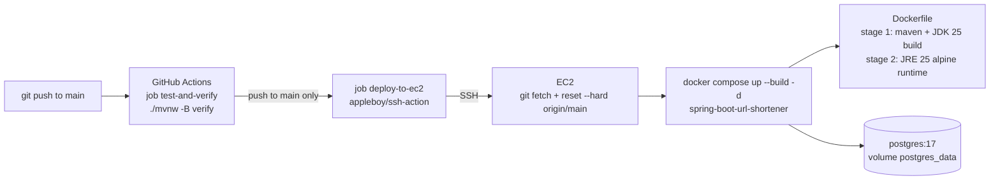

_Last Updated: 2026-10-30_

# TinyURL
## A project to learn System Design

Planned Technology Stack 
- Spring Boot 4.1.2
- bootstrap@5.3.8 -> later React
- DB : Docker/PostgreSQL with Flyway Migrations
- Redis cache 
- 

## Features
- Shorten long URLs with a randomly generated short key (optional check that the original URL exists)
- Redirect `/s/{shortKey}` to the original URL, with a click counter
- Private short URLs (visible/accessible only to their creator) and a custom expiry (1–365 days, default 30)
- Paginated public URL list, "My URLs" page and admin dashboard with Prev/Next navigation
- User registration and form login with Spring Security (BCrypt passwords)
- Role-based, method-level security (`@PreAuthorize`) with a role hierarchy `ROLE_ADMIN > ROLE_USER`
- Users can delete their own short URLs
- Custom 404 / 500 error pages

## Architecture
Single Spring Boot MVC app rendered server-side with Thymeleaf + Bootstrap.

| Layer | Package / Location | Notes |
|---|---|---|
| Web | `web.controller` (`HomeController`, `UserController`, `AdminController`), `GlobalExceptionHandler` | Thymeleaf views in `src/main/resources/templates` |
| Security | `config.WebSecurityConfig`, `services.SecurityUserDetailsService` | Form login, role hierarchy, method security |
| Service | `services` (`ShortUrlService`, `UserService`, `UrlExistenceValidator`, `EntityMapper`) | |
| Persistence | `repository` | `ShortUrlRepository` uses Spring Data JPA; `UserRepository` uses Spring `JdbcClient` |
| Database | PostgreSQL 17 | Schema & seed data via Flyway (`src/main/resources/db/migration`) |

## Prerequisites
- Java 25
- Docker (PostgreSQL container, and building/running the app container)
- Maven (or the bundled `mvnw` wrapper)

## Installation & Running Locally
```bash
./mvnw spring-boot:run
```
`spring-boot-docker-compose` starts PostgreSQL from `compose.yaml` automatically (the app service is behind the `app` profile, so it is not started). The app runs at http://localhost:8080.

To run the full stack in Docker locally instead: `docker compose up --build -d spring-boot-url-shortener`.

Sample accounts seeded by Flyway:

| Email | Password | Role |
|---|---|---|
| `admin@gmail.com` | `admin` | ADMIN |
| `siva@gmail.com` | `secret` | USER |

### Configuration (`application.properties`)
| Property | Default | Purpose |
|---|---|---|
| `app.base-url` | `http://localhost:8080` | Prefix for generated short links |
| `app.default-expiry-days` | `30` | Expiry when none is given |
| `app.validate-original-url` | `true` | Check the original URL is reachable |
| `app.page-size` | `10` | Page size for paginated lists |

Tests need Docker running (Testcontainers starts a Postgres container): `./mvnw verify`.

## Usage
| Endpoint | Access | Description |
|---|---|---|
| `GET /?page=1` | Public | Home: create form + public short URLs |
| `POST /short-urls` | Public | Create a short URL (`originalUrl`, `expirationInDays`, `isPrivate`) |
| `GET /s/{shortKey}` | Public (private links: owner only) | Redirect to the original URL |
| `GET/POST /register` | Public | Register a new user |
| `GET /login`, `POST /logout` | Public | Login / logout |
| `GET /my-urls?page=1` | Authenticated | Current user's short URLs |
| `POST /delete-urls` | USER | Delete selected URLs (`ids`) |
| `GET /admin/dashboard?page=1` | ADMIN | All short URLs |

## Deployment: build on EC2

The Docker image is **built on the EC2 instance itself** from the `Dockerfile` — no image registry (Docker Hub) is involved.
GitHub Actions only runs the tests and then tells EC2 (over SSH) to pull the latest code and rebuild.



### How the files fit together
| File | Role |
|---|---|
| `.github/workflows/deploy.yml` (at the **repo root**, `tinyURL/.github/`) | Workflow *"CI & EC2 Zero-Credit Deploy"*: job `test-and-verify` runs on PRs and pushes; job `deploy-to-ec2` runs only on push to `main`, after the tests pass. GitHub only reads workflows from the repository root. |
| `Dockerfile` | Multi-stage build. Stage 1 (`maven:3.9-eclipse-temurin-25`) downloads dependencies, then `mvn package` builds the fat jar; stage 2 (`eclipse-temurin:25-jre-alpine`) runs it with `java -jar /app/app.jar` |
| `pom.xml` → `spring-boot-maven-plugin` | Repackages `target/*.jar` into the executable fat jar the Dockerfile copies (also provides `spring-boot:run`) |
| `compose.yaml` | Project `name: url_shortner` (pinned so volumes/containers keep their names regardless of folder) · `postgres` (official `postgres:17` image, data in the `postgres_data` volume) + `spring-boot-url-shortener` (`build: .` from the `Dockerfile`, container name `shortener-app`, port 8080, `profiles: ["app"]` → only started when named or with `--profile app`) |
| `.env` (on the server, git-ignored) | Secrets and environment-specific values read by `compose.yaml` |

**Order of commands on EC2** (run by the workflow, or by hand):
```bash
cd ~/spring-boot-url-shortener && git fetch origin main && git reset --hard origin/main
docker compose up --build -d spring-boot-url-shortener   # builds the image, starts postgres first (healthcheck), then the app
docker image prune -f                                     # remove old dangling image layers
```
`--build` rebuilds the image from the new source; Docker's layer cache keeps unchanged steps (e.g. dependency download) fast.
Postgres data survives every rebuild because it lives in the `postgres_data` volume.

### One-time EC2 setup
1. **Launch** Ubuntu 24.04, `t3.small` (2 GB; the Maven build runs on the instance and needs RAM — on `t3.micro` add swap).
   Security group: **22** from your IP (and from GitHub Actions for the SSH deploy), **8080** from anywhere. Do **not** open 5432 (compose also binds Postgres to `127.0.0.1` only).
   Attach an **Elastic IP** so the address (and `APP_BASE_URL`) never changes.
2. **Install Docker + Git:**
   ```bash
   curl -fsSL https://get.docker.com | sudo sh
   sudo usermod -aG docker ubuntu   # log out and back in
   sudo apt-get install -y git
   ```
3. **Clone and create the server `.env`:**
   ```bash
   git clone https://github.com/KunalKrishna/tinyURL.git ~/spring-boot-url-shortener
   cd ~/spring-boot-url-shortener
   cp .env.example .env && nano .env
   ```
   ```ini
   POSTGRES_DB=postgresDB
   POSTGRES_USER=postgres
   POSTGRES_PASSWORD=<long-random-password>   # set BEFORE the first start
   APP_BASE_URL=http://<elastic-ip>:8080        # public URL shown in short links
   ```
   `git reset --hard` on later deploys does not touch `.env`, because it is git-ignored.
4. **First start:** `docker compose up --build -d spring-boot-url-shortener` (naming the service activates its `app` profile and starts `postgres` first), then `curl -s localhost:8080/actuator/health` → `{"status":"UP"}`.
5. **GitHub secrets** (*Settings → Secrets and variables → Actions*):

   | Secret | Value |
   |---|---|
   | `EC2_HOST` | Elastic IP or DNS name of the instance |
   | `EC2_USERNAME` | `ubuntu` |
   | `EC2_SSH_KEY` | Contents of the instance's private key (`.pem`) |

### `APP_BASE_URL`
Only the **server's** `.env` needs the public URL; your local `.env` keeps `http://localhost:8080`.
It is the prefix shown in short links (`baseUrl + '/s/' + shortKey`) and is not stored in the database, so changing it later
(e.g. to `https://your-domain`) updates every link immediately.

### Environment variables
Everything environment-specific is an env var; `application.properties` only holds local-dev defaults.

| Env var | Purpose | Default |
|---|---|---|
| `SPRING_DATASOURCE_URL` | JDBC URL (set by `compose.yaml` to `jdbc:postgresql://postgres:5432/<db>`) | `jdbc:postgresql://localhost:5432/postgresDB` |
| `SPRING_DATASOURCE_USERNAME` / `SPRING_DATASOURCE_PASSWORD` | DB credentials (from `POSTGRES_USER` / `POSTGRES_PASSWORD` in `.env`) | `postgres` / `postgres` |
| `APP_BASE_URL` | Public URL used in generated short links | `http://localhost:8080` |
| `PORT` | HTTP port (`server.port=${PORT:8080}`) | `8080` |

Health check: `/actuator/health` (also `/liveness` and `/readiness`), public, no login.

