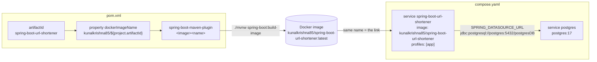

_Last Updated: 2026-10-27_

# TinyURL
## A project to learn System Design

Planned Technology Stack 
- Spring Boot 3.5.10
- bootstrap@5.3.8 -> later React
- DB : Docker/PostgreSQL with Flyway Migrations
- Redis cache
- 

## Features
- Shorten long URLs with a randomly generated short key (optional check that the original URL exists)
- Redirect `/s/{shortKey}` to the original URL, with a click counter
- Private short URLs (visible/accessible only to their creator) and a custom expiry (1–365 days, default 30)
- Paginated public URL list, "My URLs" page and admin dashboard with Prev/Next navigation
- User registration and form login with Spring Security (BCrypt passwords)
- Role-based, method-level security (`@PreAuthorize`) with a role hierarchy `ROLE_ADMIN > ROLE_USER`
- Users can delete their own short URLs
- Custom 404 / 500 error pages

## Architecture
Single Spring Boot MVC app rendered server-side with Thymeleaf + Bootstrap.

| Layer | Package / Location | Notes |
|---|---|---|
| Web | `web.controller` (`HomeController`, `UserController`, `AdminController`), `GlobalExceptionHandler` | Thymeleaf views in `src/main/resources/templates` |
| Security | `config.WebSecurityConfig`, `services.SecurityUserDetailsService` | Form login, role hierarchy, method security |
| Service | `services` (`ShortUrlService`, `UserService`, `UrlExistenceValidator`, `EntityMapper`) | |
| Persistence | `repository` | `ShortUrlRepository` uses Spring Data JPA; `UserRepository` uses Spring `JdbcClient` |
| Database | PostgreSQL 17 | Schema & seed data via Flyway (`src/main/resources/db/migration`) |

## Prerequisites
- Java 25
- Docker (PostgreSQL container, and optionally running the app as an image)
- Maven (or the bundled `mvnw` wrapper)

## Installation & Running Locally
```bash
./mvnw spring-boot:run
```
`spring-boot-docker-compose` starts PostgreSQL from `compose.yaml` automatically. The app runs at http://localhost:8080.

Sample accounts seeded by Flyway:

| Email | Password | Role |
|---|---|---|
| `admin@gmail.com` | `admin` | ADMIN |
| `siva@gmail.com` | `secret` | USER |

### Configuration (`application.properties`)
| Property | Default | Purpose |
|---|---|---|
| `app.base-url` | `http://localhost:8080` | Prefix for generated short links |
| `app.default-expiry-days` | `30` | Expiry when none is given |
| `app.validate-original-url` | `true` | Check the original URL is reachable |
| `app.page-size` | `10` | Page size for paginated lists |

Tests need Docker running (Testcontainers starts a Postgres container): `./mvnw verify`.

## Usage
| Endpoint | Access | Description |
|---|---|---|
| `GET /?page=1` | Public | Home: create form + public short URLs |
| `POST /short-urls` | Public | Create a short URL (`originalUrl`, `expirationInDays`, `isPrivate`) |
| `GET /s/{shortKey}` | Public (private links: owner only) | Redirect to the original URL |
| `GET/POST /register` | Public | Register a new user |
| `GET /login`, `POST /logout` | Public | Login / logout |
| `GET /my-urls?page=1` | Authenticated | Current user's short URLs |
| `POST /delete-urls` | USER | Delete selected URLs (`ids`) |
| `GET /admin/dashboard?page=1` | ADMIN | All short URLs |

## Deployment (Docker)

### TL;DR — command order
Docker must be running for every step.

| # | Command | What it does | Needs |
|---|---|---|---|
| 1 | `./mvnw spring-boot:build-image` | Compiles, runs tests, packages the jar, then builds a Docker image `kunalkrishna85/spring-boot-url-shortener:latest` | JDK 25, Docker |
| 2 | `docker compose --profile app up -d` | Starts the `postgres` container, then the app container from the image built in step 1 | Image from step 1 |
| 3 | open http://localhost:8080 | App is served from the container | |
| – | `docker compose --profile app logs -f spring-boot-url-shortener` | Follow app logs | |
| – | `docker compose --profile app down` | Stop & remove both containers (add `-v` to also drop DB data) | |

Re-run steps 1 → 2 after every code change: the container runs the **image**, not your source code.

> Local development is different: `./mvnw spring-boot:run` runs the app **on your machine (JVM)** and only starts Postgres in Docker. No image is built.

### How `pom.xml` and `compose.yaml` are chained together



**1. `pom.xml` names the image.**
```xml
<artifactId>spring-boot-url-shortener</artifactId>
<properties>
    <dockerImageName>kunalkrishna85/${project.artifactId}</dockerImageName>   <!-- = kunalkrishna85/spring-boot-url-shortener -->
</properties>
...
<plugin>
    <artifactId>spring-boot-maven-plugin</artifactId>
    <configuration>
        <image><name>${dockerImageName}</name></image>   <!-- no tag given → :latest -->
    </configuration>
</plugin>
```
`kunalkrishna85/` is a Docker Hub namespace; it only matters once you push the image to Docker Hub.

**2. `spring-boot:build-image` builds the image — there is no Dockerfile.**
The `spring-boot-maven-plugin` runs the normal Maven lifecycle up to `package` (compile → test → fat jar), then hands the jar to
[Cloud Native Buildpacks (Paketo)](https://paketo.io/), which run inside Docker and produce an optimized, layered image containing a JRE 25 and your app.
Dev-only dependencies (`spring-boot-devtools`, `spring-boot-docker-compose`) are left out of that jar automatically.

**3. `compose.yaml` uses the image by name.** The only link between the two files is the string `kunalkrishna85/spring-boot-url-shortener`.
Compose looks for that image locally first; if it isn't there it tries to pull it from Docker Hub.

**4. Configuration is overridden by environment variables.** `application.properties` says `spring.datasource.url=jdbc:postgresql://localhost:5432/...`,
but inside a container `localhost` is the container itself. Compose sets `SPRING_DATASOURCE_URL=jdbc:postgresql://postgres:5432/postgresDB`
(`postgres` = the service name on the Compose network). Spring Boot maps `SPRING_DATASOURCE_URL` → `spring.datasource.url`, and env vars win over the properties file.
This is the same mechanism every cloud host uses to configure the app.

**5. On startup** the app connects to Postgres, Flyway applies `db/migration/V*.sql`, then Tomcat listens on 8080, which Compose publishes as `localhost:8080`.

### What each `compose.yaml` is used for
| Scenario | Command | Starts |
|---|---|---|
| Local dev | `./mvnw spring-boot:run` | `postgres` only (via `spring-boot-docker-compose`; `app` profile not active) |
| Full stack in Docker | `docker compose --profile app up -d` | `postgres` + app container |

### Roadmap: CI/CD with GitHub Actions → EC2 / Railway / Render
The local flow above maps directly onto a pipeline — the only new pieces are a **container registry** and **secrets**:

```
git push ──► GitHub Actions
               1. checkout + setup JDK 25
               2. ./mvnw spring-boot:build-image  (tag with git SHA, e.g. -Dspring-boot.build-image.imageName=…:${{ github.sha }})
               3. docker login + docker push ──► registry (Docker Hub / GHCR / Amazon ECR)
               4. deploy ──► target pulls the image and runs it with env vars
```

| Target | How step 4 works | Database | Notes |
|---|---|---|---|
| **AWS EC2** | Action SSHes into the instance, copies `compose.yaml`, runs `docker compose --profile app pull && docker compose --profile app up -d` | Postgres container from `compose.yaml`, or Amazon RDS (just change `SPRING_DATASOURCE_URL`) | Closest to local setup; you manage the VM. Graviton (arm64) instances need an arm64 image. |
| **Render** | "Deploy an existing image" web service pointing at the registry; trigger via deploy hook URL from the Action | Render Postgres | No Compose; set env vars in the dashboard. Render injects `PORT`. |
| **Railway** | Service from a Docker image (or let Railway build from the repo) | Railway Postgres plugin | No Compose; env vars in dashboard. Railway injects `PORT`. |

### CI pipeline (`.github/workflows/ci.yml`, at the repo root)
| Trigger | Steps |
|---|---|
| Pull request → `main` | `./mvnw verify` (compile + tests; tests start a throwaway Postgres via Testcontainers) |
| Push → `main` | the above, then `spring-boot:build-image` → push `kunalkrishna85/spring-boot-url-shortener:<git-sha>` and `:latest` to Docker Hub |

**One-time setup:** in GitHub → *Settings → Secrets and variables → Actions*, add `DOCKERHUB_USERNAME` and `DOCKERHUB_TOKEN`
(a Docker Hub access token with *Read & Write*).

### Cloud-ready configuration
Everything environment-specific is an env var; `application.properties` only holds local-dev defaults.

| Env var | Purpose | Default |
|---|---|---|
| `SPRING_DATASOURCE_URL` | JDBC URL — must be `jdbc:postgresql://host:5432/db`, **not** the `postgres://…` URL managed hosts show | `jdbc:postgresql://localhost:5432/postgresDB` |
| `SPRING_DATASOURCE_USERNAME` / `SPRING_DATASOURCE_PASSWORD` | DB credentials | `postgres` / `postgres` |
| `APP_BASE_URL` | Public URL used in generated short links | `http://localhost:8080` |
| `PORT` | HTTP port (`server.port=${PORT:8080}`); set automatically by Render/Railway | `8080` |

- Health check path for Render/Railway/load balancers: `/actuator/health` (also `/actuator/health/liveness` and `/readiness`), public, no login.
- **EC2 / any Compose host:** copy `compose.yaml` and `.env.example` → `.env`, set real values, then
  `docker compose --profile app pull && docker compose --profile app up -d`. Pin a release with `IMAGE_TAG=<git-sha>`.
- Postgres data now lives in the `postgres_data` volume and survives `down`; `POSTGRES_*` values only apply when that volume is first created (`down -v` to reset).
